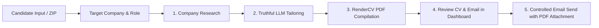

# TailorMail: RenderCV Tailoring & Automated Outreach Studio

A production-ready platform that combines [RenderCV](https://github.com/rendercv/rendercv.git) with targeted company research and tailored email outreach.

---

## Architecture & Workflow



1. **Candidate Management**:
   - Add individual candidate profiles with validated RenderCV YAML.
   - Bulk import up to 500 candidate CVs in a single `.zip` file containing `.yaml` / `.yml` files (requires `cv.name` and `cv.email`).
2. **Company & Role Research**:
   - Analyzes target company website, mission, and required tech stack.
   - Incorporates custom job descriptions and role requirements.
   - Uses the free Companies House API, DuckDuckGo, and public company websites for discovery and contact research.
3. **Truthful LLM Tailoring**:
   - Calls your configured OpenAI-compatible endpoint.
   - Strict hallucination guardrails: preserves candidate identity, degrees, employment history, and factual details while tailoring wording to match the company's culture and role.
   - Generates valid RenderCV YAML conforming to RenderCV specifications.
4. **RenderCV PDF Compilation**:
   - Compiles tailored YAML directly using RenderCV v2.8 and Typst.
   - Bundled offline Font Awesome icon assets and custom typography.
   - Generates professional, publication-quality PDF resumes.
5. **Interactive Dashboard**:
   - Modern, tabbed web interface (Applications, New Application, Candidates, Settings).
   - Side-by-side split screen with interactive PDF preview, YAML viewer, and research insights.
   - Editable email subject & body before sending.
   - Connection test buttons for both LLM API and SMTP servers.
6. **Controlled Email Dispatch**:
   - Requires explicit human review and approval.
   - Dispatches one personalized email with the tailored RenderCV PDF attached through Resend or SMTP.
   - Permanent lock preventing accidental duplicate sending.
   - Comprehensive audit trail for every action.

---

## Quickstart

### 1. Install & Setup Environment
Ensure Python 3.12+ is installed, then install requirements:
```bash
pip install -r requirements.txt
pip install "rendercv[full]"
```

### 2. Configure Environment (`.env`)
Copy `.env.example` to `.env` or configure via the Dashboard:
```ini
DATABASE_URL=sqlite:///./data/tailormail.db
APP_SECRET=your-random-secret
ENVIRONMENT=development
ALLOWED_HOSTS=localhost,127.0.0.1

# LLM Endpoint
BASE_URL=http://127.0.0.1:31415
API_KEY=your-api-key
LLM_MODEL=auto

# Email Delivery (configure when ready to send real mail)
SMTP_HOST=smtp.gmail.com
SMTP_PORT=587
SMTP_USERNAME=your-email@gmail.com
SMTP_PASSWORD=your-app-password
SMTP_FROM=your-email@gmail.com
SMTP_USE_TLS=true
```

### 3. Schedule the free daily batch

Set `COMPANIES_HOUSE_API_KEY`, `OUTREACH_CANDIDATE_ID`, `OUTREACH_QUERY`, and `OUTREACH_TARGET_ROLE` in the production environment. The runner uses only Companies House, DuckDuckGo, public websites, your configured AI endpoint, local RenderCV, and your configured mail provider.

```bash
python -m app.daily_outreach
```

Run that command once per day using your host scheduler (for example, Windows Task Scheduler). It prepares up to `OUTREACH_DAILY_LIMIT=100` unique companies, pages through Companies House results, and skips companies already recorded by name or company number. Use semicolons in `OUTREACH_QUERY` to try several search terms. The timezone-aware send budget prevents more than the configured daily limit from being sent, even if the runner is triggered twice. Set `OUTREACH_AUTO_SEND=true` only after verifying the workflow and sender compliance; otherwise campaigns remain `ready` for dashboard review. Before crawling, the worker verifies the candidate, CV quality, sender, AI, discovery key, timezone, and 100-per-day target; it exits nonzero if the target is missed.

On Windows, install the daily task after configuring the production environment:

```powershell
.\scripts\install-daily-outreach-task.ps1 -Time "09:00"
```

### 4. Start the Web Dashboard
```bash
python -m uvicorn app.main:app --host 127.0.0.1 --port 8000 --reload
```
Open [http://localhost:8000](http://localhost:8000) in your browser.

### 5. Production VPS

The production Compose stack uses PostgreSQL, non-root application execution, container health checks, persistent artifact storage, and an internal-only application port for a TLS reverse proxy. Deployment, Caddy, systemd daily-worker, and backup instructions are in [deploy/README.md](deploy/README.md). Do not copy development SQLite or secrets to the VPS; create its `.env` from `.env.example` there.

---

## Running Tests

### Automated Test Suite
```bash
python -m pytest -v
```

### End-to-End A-to-Z Pipeline Verification
```bash
python test_e2e_live.py
```
This script executes the complete lifecycle: candidate registration, target application creation, research, truthful tailoring, RenderCV PDF compilation (verifying PDF magic bytes & size), email review/editing, and approved SMTP dispatch with duplicate-send protection.
